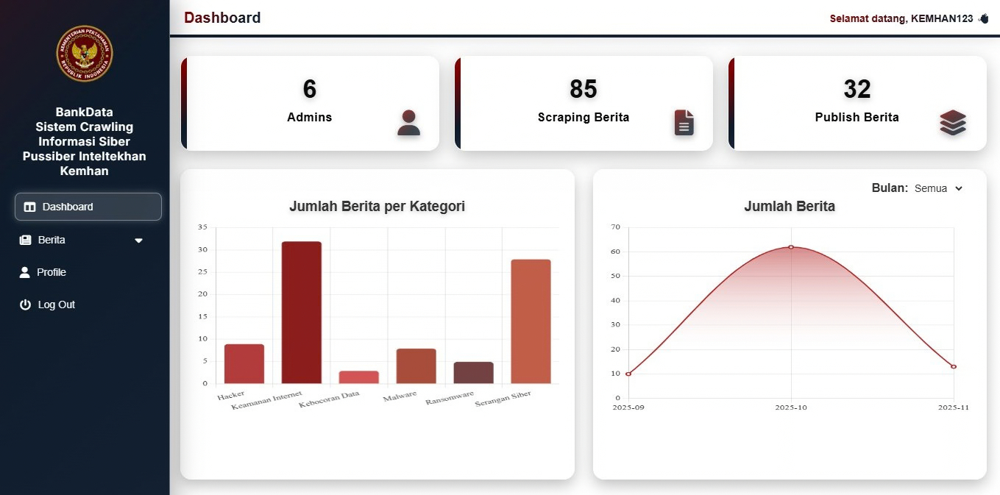
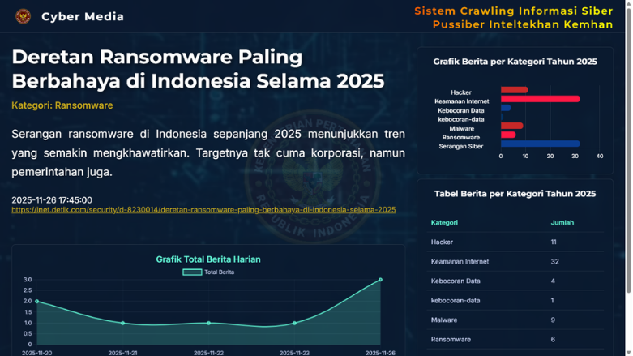

# Cyber Media & BankData

A web application for managing technology and cybersecurity news. It includes an admin panel for collecting and reviewing news, managing publication status, and a public-facing site for displaying active stories and statistics.

## Screenshots

### BankData Admin Panel



### Cyber Media Website



## Features

- Collects news from technology and cybersecurity RSS feeds.
- Groups stories into thematic categories such as malware, ransomware, and data breaches.
- Provides an admin panel to review, edit, delete, and manage news publication status.
- Displays news summaries and charts on the dashboard.
- Publishes active stories on the Cyber Media website.

## Tech Stack

- PHP with MySQLi
- MySQL
- Python with `requests`, `beautifulsoup4`, and `PyMySQL`
- JavaScript for charts and interface interactions

## Project Structure

```text
bankdata/    Admin panel and news collection tools
cybermedia/  Public site for active news stories
screenshot_web/ Project screenshots used in this README
```

## Local Setup

1. Install PHP with the MySQLi extension, MySQL, and Python 3.
2. Create the databases and tables used by the application (`db_admin` and `data_crawl`). The database schema is not included in this repository.
3. Configure the environment variables listed in `.env.example` for both the PHP web server and the shell running Python. `.env.example` documents the variable names; PHP does not load a `.env` file automatically.
4. Install the Python dependencies:

   ```bash
   python -m pip install requests beautifulsoup4 PyMySQL
   ```

5. Serve `bankdata/` and `cybermedia/` as separate application directories using a local PHP server. Configure the same database environment variables for PHP and Python.
6. Run the news scraper from the `bankdata/` directory:

   ```bash
   python scraping.py
   ```

## Notes

- Database credentials are not stored in this repository. Do not commit a `.env` file or put passwords in source code.
- Scraper logs and temporary files are excluded by Git.
- This project is presented as a portfolio demonstration. Review authentication, input validation, and endpoint protections before deploying it to a public server.
- Make sure you have permission to publish the included logos, background video, and other assets.
